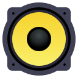

  

  # GNOME Music

  Play and organize your music collection

  

## Installation

## Links

- Homepage: [apps.gnome.org/Music]
- Report an issue: [gitlab.gnome.org/GNOME/gnome-music/-/work_items]
- Donate: [donate.gnome.org]
- Translate: [l10n.gnome.org/module/gnome-music]
- Contact: [matrix.to/#/#gnome-music:gnome.org]

## Contributing

For information on how to contribute, please check [CONTRIBUTING.md](CONTRIBUTING.md).

[apps.gnome.org/Music]: https://apps.gnome.org/Music
[gitlab.gnome.org/GNOME/gnome-music/-/work_items]: https://gitlab.gnome.org/GNOME/gnome-music/-/work_items
[donate.gnome.org]: https://donate.gnome.org/
[l10n.gnome.org/module/gnome-music]: https://l10n.gnome.org/module/gnome-music/
[matrix.to/#/#gnome-music:gnome.org]: https://matrix.to/#/#gnome-music:gnome.org/

